# DataRescue

[](https://github.com/saxipatel/datarescue-ai/actions/workflows/ci.yml)


DataRescue is a data reliability control plane for batch transaction pipelines. It:

- validates incoming events against a contract;
- quarantines bad rows without losing them;
- opens an incident when a quality rule breaches its threshold;
- explains the likely cause from evidence;
- traces the downstream datasets and dashboards at risk;
- runs bounded, human-approved, idempotent repairs, which are verified before an incident closes.

All data is synthetic. This is a portfolio and learning project, not a certified financial
system.

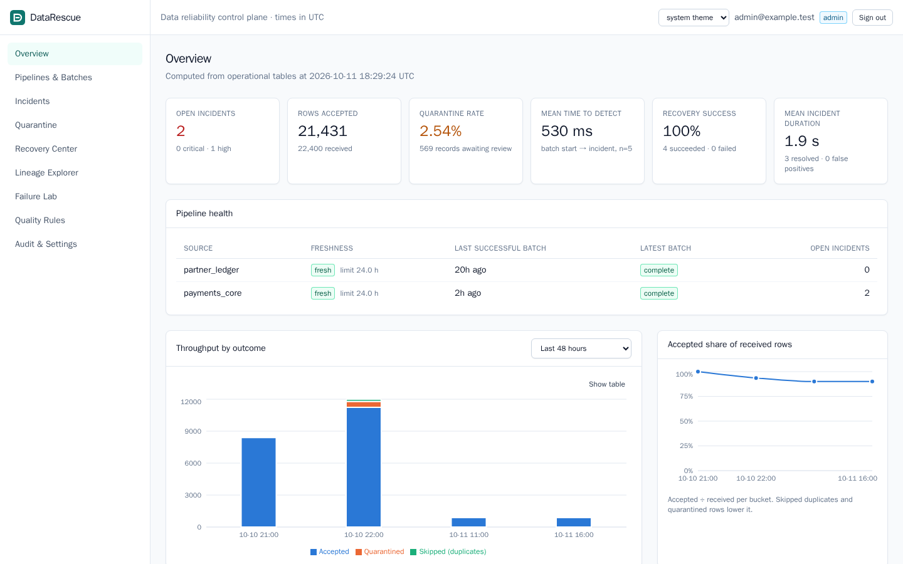

<sub>Overview dashboard, captured from a locally running instance at 1440×900. Every screenshot in this README comes from that same instance and its existing data.</sub>

## Contents

- [Why](#why)
- [How it works](#how-it-works)
- [Architecture](#architecture)
- [Visual walkthrough](#visual-walkthrough)
- [Verified results](#verified-results)
- [Quick start](#quick-start)
- [Tech stack](#tech-stack)
- [Engineering decisions](#engineering-decisions)
- [Configuration](#configuration)
- [Troubleshooting](#troubleshooting)
- [Benchmarks](#benchmarks)
- [API](#api)
- [Repository layout](#repository-layout)
- [Known limitations](#known-limitations)
- [Future work](#future-work)

## Why

Most pipelines fail in mundane ways: a producer retries a batch, an upstream deploy renames
a field, currency codes arrive in lower case, or a batch never shows up. The usual
responses are dropping rows or hand-editing production tables, and both lose evidence and
invite double counting. DataRescue treats each of these as an incident with a lifecycle:

1. detect it;
2. keep the evidence;
3. explain it;
4. propose a bounded fix;
5. get approval;
6. apply the fix idempotently;
7. prove the result.

## How it works

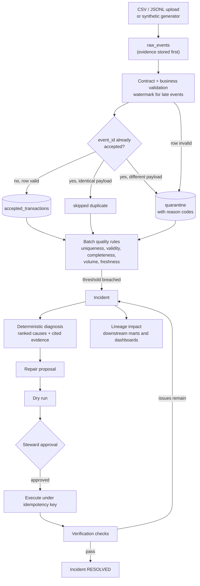

1. **Ingestion.** CSV or JSONL files, or generated batches, are streamed in 1,000-row
   chunks. Each chunk is one transaction, and a durable checkpoint is written with it, so a
   crashed batch resumes where it stopped and never double counts. Files are never loaded
   into memory whole.
2. **Raw evidence first.** Every received row lands in `raw_events` before any decision is
   made about it.
3. **Validation.** Rows are checked for:
   - required fields;
   - Decimal-only amounts (> 0, at most two decimals);
   - a currency allowlist;
   - the status enum;
   - schema version;
   - unexpected and missing fields;
   - impossible timestamps;
   - unparseable rows.

   Late events are detected against an event-time watermark with a per-source grace window.
4. **Deduplication, enforced by the database.**
   - An identical repeat of an accepted `event_id` is skipped.
   - A repeat with a different payload is quarantined as a conflict.
   - Duplicates never advance the watermark.
5. **Quarantine.** Failed rows keep their original payload, reason codes and per-field
   details. They can be inspected, exported to CSV (with formula neutralization), or
   replayed by a repair.
6. **Batch rules and incidents.** Uniqueness, validity, completeness (manifest count and
   sequence gaps), volume against a median baseline, and per-source freshness are evaluated
   per batch. A breach opens an incident. Incidents have a server-enforced state machine,
   optimistic locking and an audit trail.
7. **Diagnosis.** A deterministic engine ranks suspected causes with heuristic confidence
   labels, cites supporting and contradicting evidence, and recommends an allowlisted
   repair. Optional LLM enrichment exists behind a feature flag. It is **off** by default,
   sees only redacted data, and its output is labelled unverified.
8. **Human-approved recovery.** There are five bounded repair actions:
   `SKIP_IDENTICAL_DUPLICATE`, `NORMALIZE_CURRENCY_CASE`, `REPLAY_QUARANTINED`,
   `RETRY_MISSING_BATCH` and `MANUAL_REVIEW_REQUIRED`. Each one goes through the same steps:
   1. proposal;
   2. dry run;
   3. approval by a steward;
   4. execution under an idempotency key, guarded by a Postgres advisory lock.

   Resubmitting the same key returns the finished job instead of writing again.
9. **Verification.** After execution, every job checks that there are no duplicate event
   IDs and that the counts reconcile. Each repair action also has its own checks:
   - repairs that insert rows: the rows written equal the dry-run prediction and the
     accepted-row delta;
   - `SKIP_IDENTICAL_DUPLICATE` and `MANUAL_REVIEW_REQUIRED`: the business data checksum is
     unchanged;
   - `RETRY_MISSING_BATCH`: the sequence gap is closed.

   Only when every check passes does the incident move to RESOLVED. If issues remain, it
   returns to ACTION_REQUIRED and names them.

## Architecture

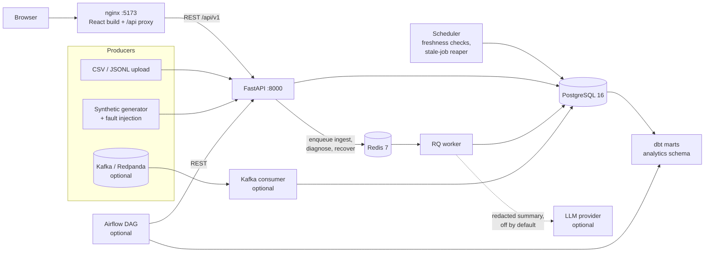

- The API stores state and enqueues long-running work: `ingest_batch_task`,
  `diagnose_task` and `recovery_task` in `backend/app/workers/tasks.py`.
- The worker runs that work and writes results to PostgreSQL, the system of record.
- PostgreSQL also enforces several rules itself: `event_id` uniqueness, CHECK constraints
  on approvals, and an append-only trigger on `audit_events`.
- The scheduler is a separate process from the same image.
- Optional services sit behind Compose profiles and are not started by default.

Ingestion path inside the worker, per 1,000-row chunk and in one transaction:

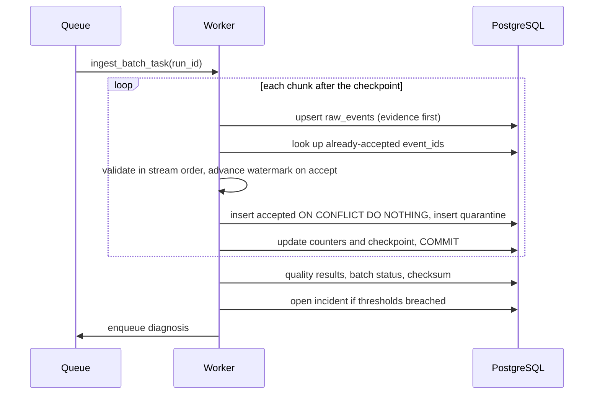

More detail, including the recovery sequence and design tradeoffs, is in
[docs/architecture.md](docs/architecture.md).

## Visual walkthrough

These screenshots were captured with Playwright (1440×900, light theme) from the
application running locally in Docker. They show its existing data, and no records were
created or changed to take them. Customer IDs are masked by the application itself
(`C***76`). Only synthetic demo data appears.

### Pipelines and batches

Every ingested batch, with its source, status and row outcomes.

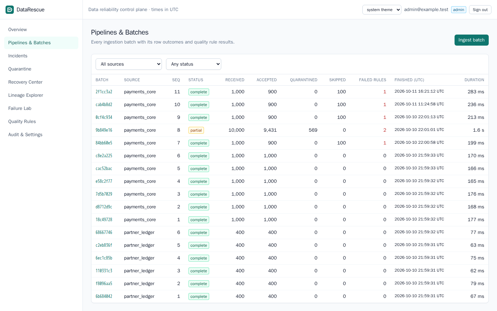

The batch detail below is for a 1,000-row Failure Lab run with 10% duplicate event IDs:
1,000 expected and received, **900 accepted, 100 skipped as identical duplicates,
0 quarantined**, and the count reconciles. The per-rule quality results are listed
underneath.

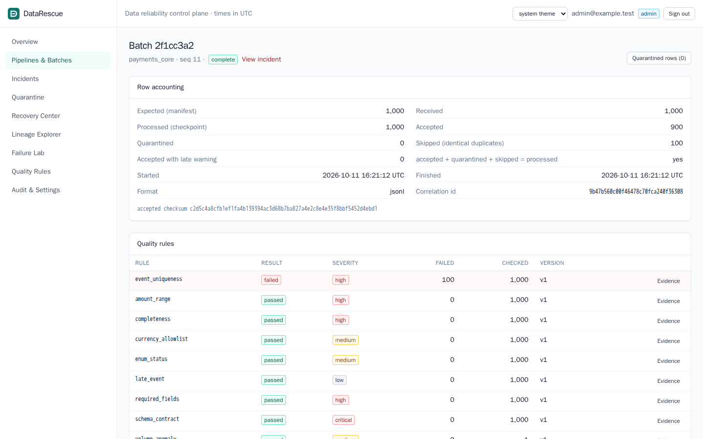

### Incident diagnosis

The incident opened by that batch. The `event_uniqueness` rule breached at 100 of 1,000
rows. The deterministic diagnosis ranks a non-idempotent upstream retry first, with high
confidence: 66 skipped rows match events accepted from an earlier batch. In-batch
repeats come second. The recommended action is `SKIP_IDENTICAL_DUPLICATE`. The right-hand
panel shows the downstream marts and dashboards at risk. This incident is deliberately
left in ACTION_REQUIRED, waiting for a human to propose and approve a repair.

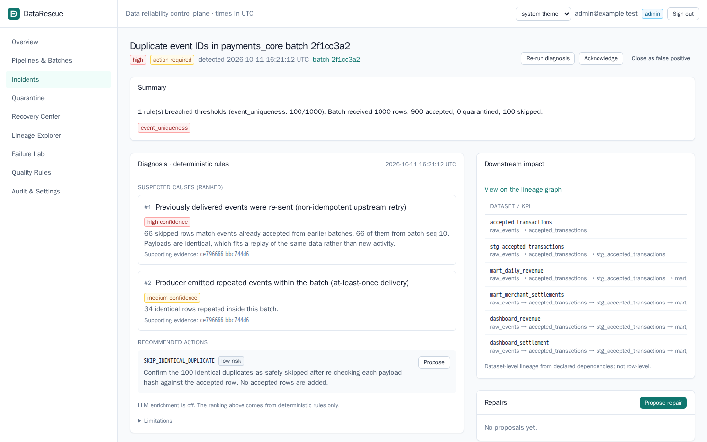

### Quarantine

Rows that failed validation from a batch with malformed currencies, with their reason codes
(`CURRENCY_NOT_ALLOWED`, `CURRENCY_INVALID_FORMAT`).

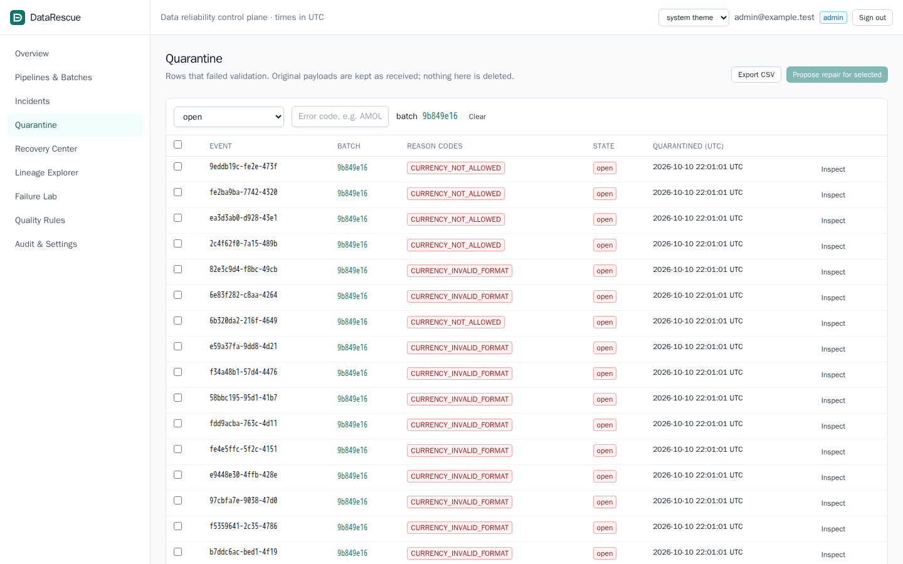

Inspecting a record shows the per-field error details and the original payload. The
`customer_id` is redacted by the API.

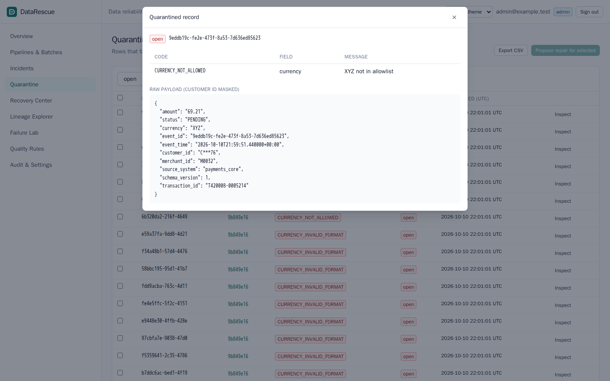

### Recovery Center

A completed `NORMALIZE_CURRENCY_CASE` recovery. This run was the chaos demo: the job was
crashed partway through and retried with the same idempotency key, which is why it shows
2 attempts. Verification **PASSED**: the dry run predicted 1,431 rows and the job wrote
1,431. The audit trail records the injected crash and the retry.

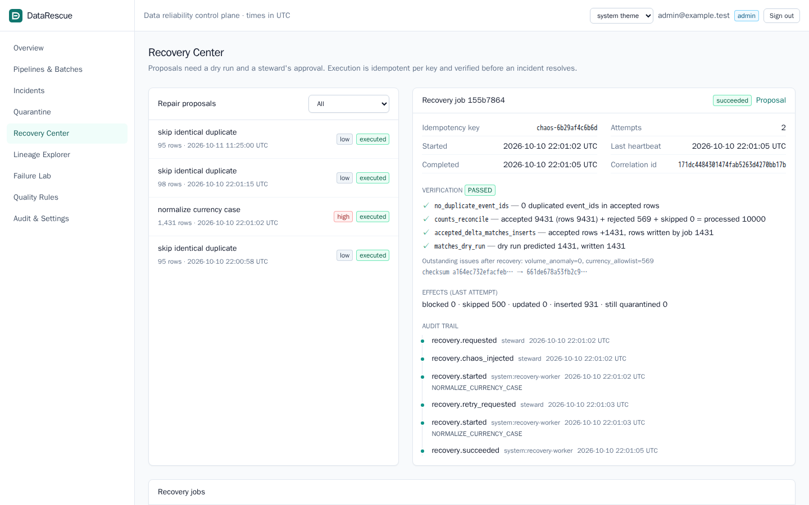

### Data lineage

Dataset-level lineage for the open incident. The origin (`raw_events`) is highlighted in
red, and everything downstream of it is highlighted in amber, down to the marts and
dashboards. A table lists the same nodes for accessibility.

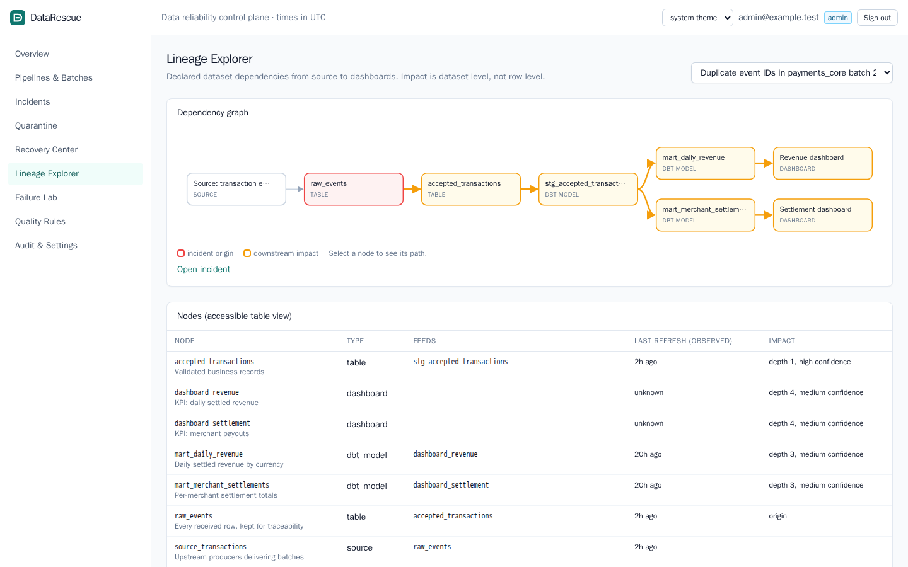

### Failure Lab

The fault-injection lab. Each run injects a deterministic, labelled fault and compares
what the platform detected with the generator's ground truth. In the recent runs, the
1,000-row `duplicate event ids` run at 10% (`manual-duplicate-test-01`) shows counts
**match** the labels, with **0 false positives / 0 false negatives**. The 900 / 100 split
for the same run is in the batch detail above.

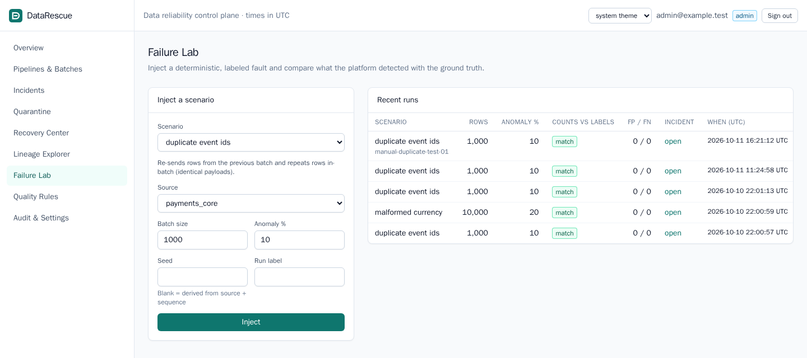

### Audit log

Admins can read the audit log, along with the environment and readiness checks. Every
state change is recorded with actor, role, action, entity, before/after hashes and a
correlation ID. Updates and deletes are blocked by a database trigger.

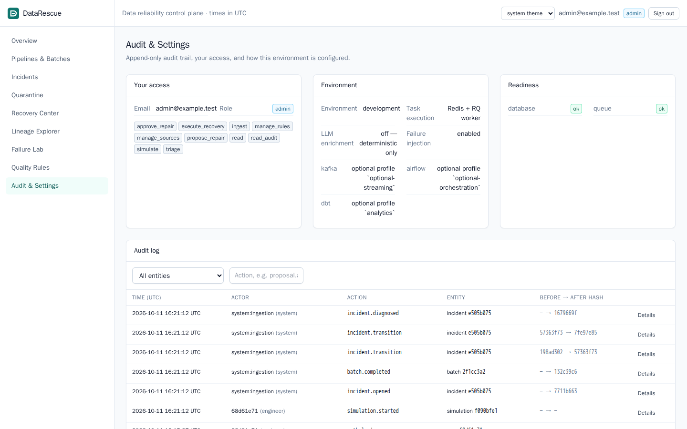

Filtered to recovery jobs: `recovery.requested`, `recovery.started` and `recovery.succeeded`
events.

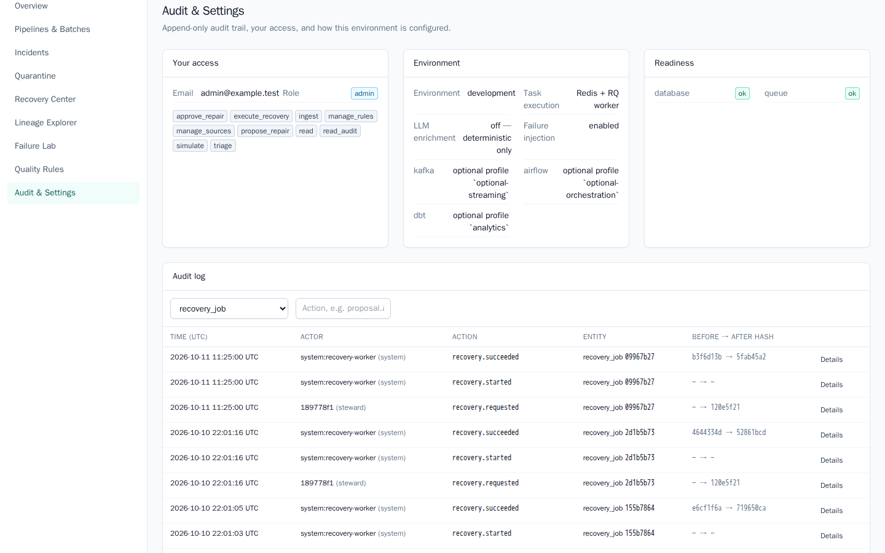

## Verified results

Every push runs the checks below in GitHub Actions ([workflow](.github/workflows/ci.yml)).
The most recent run,
[38159559091](https://github.com/saxipatel/datarescue-ai/actions/runs/38159559091) on
commit `6beb3ce`, passed all four jobs:

| CI job | What it checks | Result |
|---|---|---|
| backend | Ruff, format check, mypy, Alembic up → down → up, pytest against PostgreSQL 16 | **172 passed, 89% line coverage** |
| dbt | `dbt build` (3 models, 20 tests) | **23 of 23 pass** |
| frontend | ESLint, `tsc --noEmit`, `vite build` | pass |
| e2e | full Docker stack, `make demo-chaos`, Playwright | demo: 1,431 rows predicted = 1,431 written; Playwright **3 passed**, 1 skipped (the opt-in screenshot spec) |

Also verified locally (2026-10-10, Apple M4, Docker Desktop):

- `mypy app` reports no issues in 65 files.
- A Playwright check finds no horizontal scroll at 375 px on 13 views.
- Airflow `dags test datarescue_pipeline` succeeded on all 6 tasks against the live API.
- The benchmarks [below](#benchmarks) match ground truth at 1k, 10k and 100k rows.

The integration suite covers:

- every fault scenario against ground truth;
- crash-and-resume ingestion;
- crash-and-retry recovery;
- concurrent executors;
- approval rules and separation of duties;
- the append-only audit trigger;
- Kafka micro-batch replays (without a broker);
- HTTP behaviour: auth failures, 403, 404, 409, 422, 503 when Redis is unreachable, and
  CSV formula neutralization.

The acceptance matrix is in [IMPLEMENTATION_STATUS.md](IMPLEMENTATION_STATUS.md).

## Quick start

**Requirements:**

| Tool | Why | How to get it on a Mac |
|---|---|---|
| Docker Desktop with Compose v2.24+ | runs every service, test and tool | [docker.com/products/docker-desktop](https://www.docker.com/products/docker-desktop/) |
| GNU make | the commands below | `xcode-select --install` (preinstalled on most Macs) |
| git | to clone | included with the Xcode command line tools |

Python, Node, PostgreSQL, Redis and dbt all run in containers, so you don't need any of
them on the host. Give Docker Desktop at least 4 GB of memory. The project was developed
on an Apple M4 (arm64). The images are multi-arch, and CI runs on Linux x86-64.

```bash
git clone https://github.com/saxipatel/datarescue-ai.git
cd datarescue-ai
make setup        # create .env, build images, wait for Postgres, migrate, seed demo data
make up           # start postgres, redis, api, worker, scheduler, frontend
```

`make setup` creates `.env` from [.env.example](.env.example). The defaults work for local
use, and no API key is needed. `docker compose up --build` on its own also works, because
the one-shot `migrate` service applies migrations and seeds the data before the API starts.

**Open the app:**

- Console: http://localhost:5173
- API docs (OpenAPI): http://localhost:8000/docs
- Readiness: http://localhost:8000/api/v1/ready

**Demo accounts** (local development only). The seed creates these four accounts, and all
of them use the password `datarescue-demo`:

| Account | Role | Can |
|---|---|---|
| `engineer@example.test` | engineer | ingest, run failure scenarios, diagnose, propose repairs, execute approved recoveries |
| `steward@example.test` | steward | everything an engineer can triage, plus approve or reject repairs |
| `admin@example.test` | admin | all of the above, edit rules, read the audit log |
| `analyst@example.test` | analyst | read only |

**Try the flow** (in the browser, or scripted with `make demo`):

1. Sign in as **engineer@example.test**.
2. In **Failure Lab**, inject `duplicate event ids` into a 1,000-row batch at 10%. The
   result card compares observed counts with ground truth: 900 accepted, 100 skipped,
   0 false positives.
3. Choose **Inspect incident** and read the evidence, the diagnosis and the lineage impact.
4. Choose **Propose**, then **Run dry run**. Engineers cannot approve.
5. Sign in as **steward@example.test**, then **Approve** and **Execute recovery**.
6. Check the verification results. The incident moves to RESOLVED.
7. Choose **Submit again with the same key**. The finished job is returned and no rows are
   added.

**Tests and other commands:**

```bash
make test         # backend pytest (unit + integration) and frontend lint, typecheck, build
make lint         # ruff, formatting, mypy, eslint, tsc
make e2e          # Playwright UI tests against the running stack (needs `make up`)
make demo-chaos   # scripted failure, crash mid-repair, retry with the same key, verification
make dbt          # build and test the analytics marts
make down         # stop, keep data
make reset        # delete all data volumes and start fresh (asks you to type 'reset')
```

Other targets:

- `make logs`
- `make seed` (idempotent)
- `make benchmark`
- `make streaming-up` (optional Redpanda and Kafka consumer)
- `make orchestration-up` (optional Airflow on :8080)
- `make help`

## Tech stack

| Layer | Choice |
|---|---|
| API | Python 3.12, FastAPI, Pydantic v2, SQLAlchemy 2, Alembic |
| Database | PostgreSQL 16 (system of record; JSONB evidence, CHECK constraints, triggers, advisory locks) |
| Background work | Redis 7 + RQ worker, built-in scheduler process |
| Frontend | React 18, TypeScript, Vite, React Router, TanStack Query, Recharts, Tailwind CSS, served by nginx |
| Analytics | dbt-postgres 1.8 |
| Optional | Redpanda (Kafka API) consumer, Airflow 2.10 DAG, Anthropic SDK for LLM enrichment (off) |
| Tooling | pytest, Ruff, mypy, ESLint, tsc, Playwright, GitHub Actions, Docker Compose, make |

## Engineering decisions

Each decision has a short ADR in [docs/decisions/](docs/decisions/).

- **PostgreSQL as the system of record**
  ([ADR 0001](docs/decisions/0001-postgresql-system-of-record.md)). Rules that must never be
  broken are enforced in the database as well as in code:
  - unique `event_id` on accepted rows;
  - `NUMERIC(18,2)` money;
  - CHECK constraints on approvals;
  - an append-only audit trigger.
- **Redis + RQ for background work** ([ADR 0002](docs/decisions/0002-redis-rq.md)). It is
  simple, observable and enough for one machine. The API stays responsive and returns
  `202` with a status URL. If Redis is down, the API returns 503 instead of silently losing
  work.
- **Deterministic diagnosis first**
  ([ADR 0003](docs/decisions/0003-deterministic-diagnosis.md)). Causes are ranked by
  explicit rules over the evidence, so results are reproducible and testable without a
  model. The optional LLM can only add an unverified summary. It cannot propose, approve or
  execute anything.
- **Idempotency by design** ([ADR 0004](docs/decisions/0004-idempotency.md)):
  - ingestion requests are keyed by request key or file hash;
  - chunks commit together with their checkpoint;
  - recoveries run under an idempotency key and a Postgres advisory lock.

  Crashing and retrying always converges to the dry-run prediction.
- **Optional streaming and orchestration**
  ([ADR 0005](docs/decisions/0005-optional-streaming-orchestration.md)). The Kafka consumer
  and the Airflow DAG reuse the same ingestion path. They sit behind Compose profiles so the
  core stack stays small.
- **Batch-level rules, evaluated when a batch finishes.** This is simpler and easy to
  reason about, but detection latency equals ingestion time (see
  [limitations](#known-limitations)).

## Configuration

Every backend container reads `.env`. Compose supplies the database and Redis URLs.

| Variable | Default | Purpose |
|---|---|---|
| `JWT_SECRET` | dev placeholder | HS256 key, at least 32 bytes. Startup refuses the placeholder when `ENVIRONMENT=production`. |
| `CHAOS_ENABLED` | `true` in `.env.example` | Allows `chaos_crash_after` on recoveries, for failure demos |
| `FRESHNESS_CHECK_INTERVAL_SECONDS` | `300` | Scheduler period for freshness checks and the stale-job reaper |
| `INGESTION_CHUNK_SIZE` | `1000` | Rows per transaction and checkpoint |
| `MAX_UPLOAD_BYTES` | 50 MB | Upload limit |
| `LLM_ENABLED`, `LLM_API_KEY`, `LLM_MODEL` | off | Optional diagnosis enrichment (see [ADR 0003](docs/decisions/0003-deterministic-diagnosis.md)) |

To turn on the LLM enrichment:

1. Set `LLM_ENABLED=true` and `LLM_API_KEY=...` in `.env`.
2. Add `anthropic>=1.0` to the backend image (the `llm` extra in `backend/pyproject.toml`).
3. Run `make up`.

Never commit `.env`; it is gitignored.

Quality thresholds (allowed currencies, maximum amount, failure percentages) live in the
`quality_rules` table. Admins edit them in the UI, and each change is versioned and
audited.

## Troubleshooting

| Problem | Fix |
|---|---|
| `port is already allocated` (5432, 6379, 8000 or 5173) | Another Postgres, Redis or dev server is using the port. Stop it, or change the left-hand port in `docker-compose.yml`. |
| `make setup` stalls on the first build | It is downloading images and dependencies; later builds use the cache. Check Docker Desktop has network access and enough disk space. |
| Containers restart or are killed | Raise Docker Desktop's memory to 4 GB or more. |
| The UI shows a blank page or errors | `make ps` should list api, worker, scheduler and frontend as up; `make logs` shows API errors with correlation IDs. |
| Running a second copy at the same time | `COMPOSE_PROJECT_NAME=other make setup` gives it separate volumes and networks (stop the first copy first, since the host ports are fixed). |

More operational procedures are in [docs/runbook.md](docs/runbook.md).

## Benchmarks

`make benchmark` runs [scripts/benchmark.py](scripts/benchmark.py) against a separate
database, which is reset before each size. Each size uses a `mixed_faults` dataset with 10%
faulty rows (seed 42) and runs in its own process.

Measured on 2026-10-10:

- Apple M4 (10 cores), Docker Desktop VM with 7.7 GB visible;
- PostgreSQL 16.15 in a container, Python 3.12;
- one synchronous ingestion process.

| Records | Generate rows/s | Validate rows/s | Ingest rows/s | Ingest time | Counts = ground truth | False pos. / neg. | Re-send same file: rows added | Crash + retry recovery | Peak RSS |
|---:|---:|---:|---:|---:|:-:|:-:|---:|---:|---:|
| 1,000 | 134,318 | 165,821 | 4,315 | 0.23 s | yes | 0 / 0 | 0 | 0.05 s, verified | 147 MB |
| 10,000 | 150,261 | 168,313 | 5,734 | 1.74 s | yes | 0 / 0 | 0 | 0.20 s, verified | 148 MB |
| 100,000 | 154,380 | 169,185 | 6,057 | 16.5 s | yes | 0 / 0 | 0 | 1.87 s, verified | 148 MB |

How to read the table:

- **Ingest** covers the whole write path: reading, hashing, raw evidence, validation,
  accepted and quarantine writes, quality evaluation and the incident. Database round
  trips dominate; validation alone runs at roughly 165k rows/s.
- **Detection latency** equals ingestion time, because rules are evaluated when the batch
  finishes.
- **Peak RSS** stays flat from 1k to 100k rows because files are streamed.
- **Replay correctness:** at every size, a crashed-then-retried `NORMALIZE_CURRENCY_CASE`
  recovery wrote exactly the dry-run prediction (4, 82 and 841 rows), with zero duplicate
  event IDs.
- These are single-machine figures from one run, not a capacity claim.

## API

The base path is `/api/v1`. Errors share one shape:
`{"code", "message", "details", "correlation_id"}`. Lists use `limit` and `offset`.
Long-running operations return `202` with a status URL. The full reference, with
400/401/403/404/409/422/503 examples, is in [docs/api.md](docs/api.md), and interactive
docs are served at `/docs`.

| Method and path | Purpose |
|---|---|
| `GET /health`, `GET /ready` | liveness; database and queue readiness |
| `POST /auth/login`, `GET /auth/me` | bearer token; current user and permissions |
| `GET/POST /sources` | list sources; create (admin) |
| `POST /datasets/generate` | seeded synthetic dataset with ground-truth manifest |
| `POST /ingestions`, `POST /ingestions/upload` | ingest a generated dataset or an uploaded file (idempotent per request key / file hash) |
| `GET /batches`, `GET /batches/{id}`, `POST /batches/{id}/resume` | batches, rule results and run log; resume from checkpoint |
| `GET /quality/rules`, `PATCH /quality/rules/{id}`, `GET /quality/results` | rules (versioned, audited) and results |
| `GET /incidents`, `GET /incidents/{id}` | list and filter; detail with evidence, diagnosis, timeline |
| `POST /incidents/{id}/acknowledge`, `/close`, `/diagnose` | transitions (with justification); queue diagnosis |
| `GET /lineage`, `GET /incidents/{id}/impact` | dependency graph; downstream impact |
| `GET /quarantine`, `GET /quarantine/{id}`, `GET /quarantine/export.csv` | failed rows, reason codes; CSV export |
| `POST /repairs/proposals`, `/{id}/approve`, `/{id}/reject` | bounded proposals and review |
| `POST /recoveries/dry-run`, `POST /recoveries`, `GET /recoveries/{id}` | preview; execute with idempotency key; state and verification |
| `POST /simulations`, `GET /simulations` | fault injection and evaluation |
| `GET /metrics/overview`, `/timeseries`, `/revenue` | dashboard statistics; dbt revenue mart |
| `GET /audit` | audit log (admin) |

## Repository layout

```
backend/
  app/
    api/           FastAPI routers (system, data, incidents, recovery, ops)
    models/        SQLAlchemy models and enums
    schemas/       Pydantic request/response models
    services/      ingestion engine, quality evaluation, incidents, pipeline, metrics, audit
    quality/       event contract, row validator, rule catalog
    diagnosis/     deterministic engine, optional LLM enrichment, redaction
    lineage/       graph traversal and lineage service
    recovery/      target resolution, proposals and approval, executor and verification
    datagen/       deterministic synthetic data and fault injection
    workers/       queue, task bodies, worker and scheduler entry points
    security/      password hashing, JWT, role permissions
    repositories/  pagination helper
  alembic/         migrations (0001 schema, 0002 integrity triggers)
  tests/           unit/ and integration/ (pytest)
frontend/          React console (served by nginx), Playwright tests in e2e/
dbt/               staging view, revenue and settlement marts, tests
scripts/           seed, fixture generator, scripted demo, benchmark
data/              sample/ (small CSV), fixtures/ (manifests; data regenerated), benchmarks/
optional/          kafka/ producer and consumer, airflow/ DAG
docs/              architecture, data contracts, API, runbook, security, ADRs, images/
infra/             Postgres init script (test and benchmark databases)
```

## Known limitations

- **Single tenant, local auth.** There are four demo accounts with JWTs and fixed roles. There is no
  SSO, password reset, user management UI or token revocation.
- **Local-development network exposure.** Compose publishes Postgres, Redis, the API and
  the frontend on the host. Postgres uses a fixed development password, and Redis has no
  authentication. Don't expose these ports beyond your machine (see
  [docs/security.md](docs/security.md)).
- **Batch-level detection.** Rules run at the end of each batch, so a very large batch
  surfaces its incident only when it finishes.
- **Dataset-level lineage** comes from declared edges. Impact means "this dataset is
  downstream", not "these rows changed".
- **Diagnosis is heuristic.** Confidence labels are not calibrated probabilities. The LLM
  path is unit-tested with stubbed responses, but it has not been exercised against a live
  API key.
- **`RETRY_MISSING_BATCH` only works for the synthetic source**, which can regenerate a
  batch deterministically.
- **Kafka is at-least-once.** If a replay is chunked differently from the original, the
  accepted rows stay protected by `event_id` uniqueness, but they appear as skipped
  duplicates in a new batch.
- **Audit rows are append-only by trigger.** A database superuser can still disable the
  trigger, and there is no external tamper evidence.
- **Throughput** is one process per batch, around 6k rows/s on the machine above. There is
  no partitioning or parallel chunk processing.
- **Dependencies.** React Router 6 and some dev-only build tooling have open moderate
  advisories. The fixes need major-version upgrades (React Router 7, Vite and Tailwind
  majors) that haven't been made yet.
- **No PCI scope.** The generator never produces card numbers, and the project makes no
  compliance claim.

## Future work

- Parallel chunk workers and `COPY`-based raw loading for higher ingest rates
- Incremental (per-chunk) rule evaluation for earlier detection on large batches
- Column-level lineage from dbt manifests
- OpenTelemetry traces across API, worker and database
- Alert delivery (Slack, email) with acknowledgement links
- OIDC login and finer-grained, per-source permissions
- Great Expectations adapter for teams with existing suites

## License

[MIT](LICENSE)
