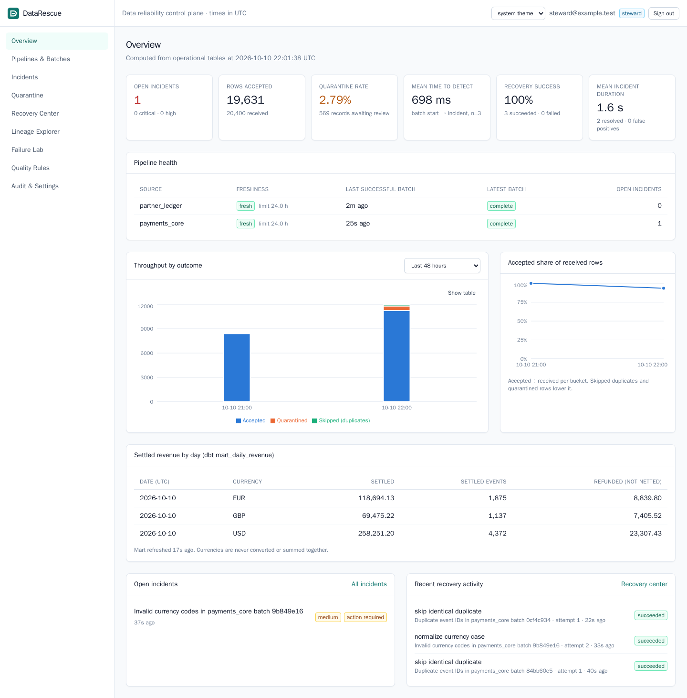
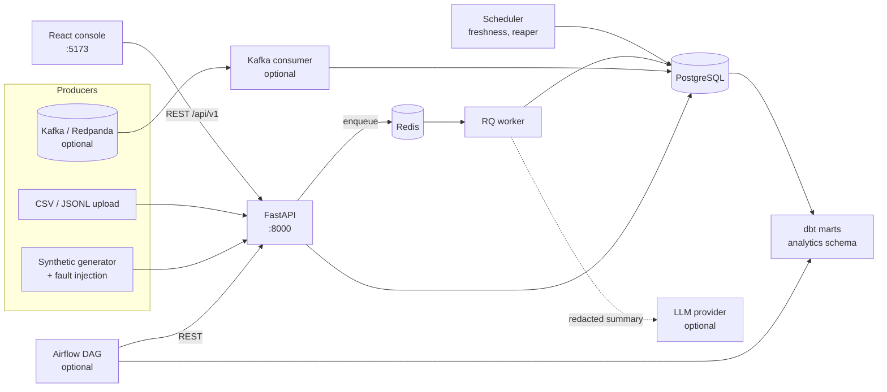
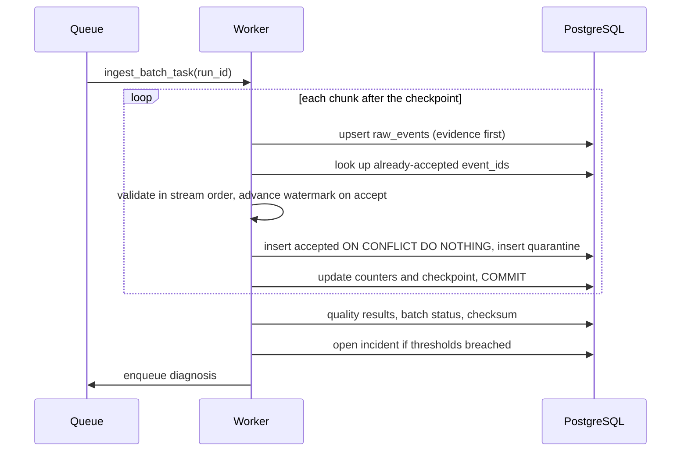
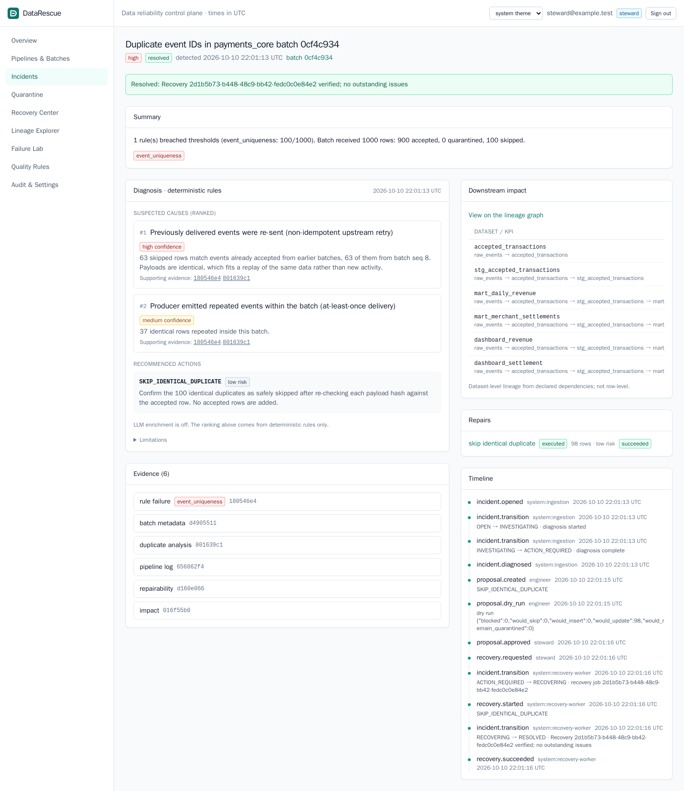
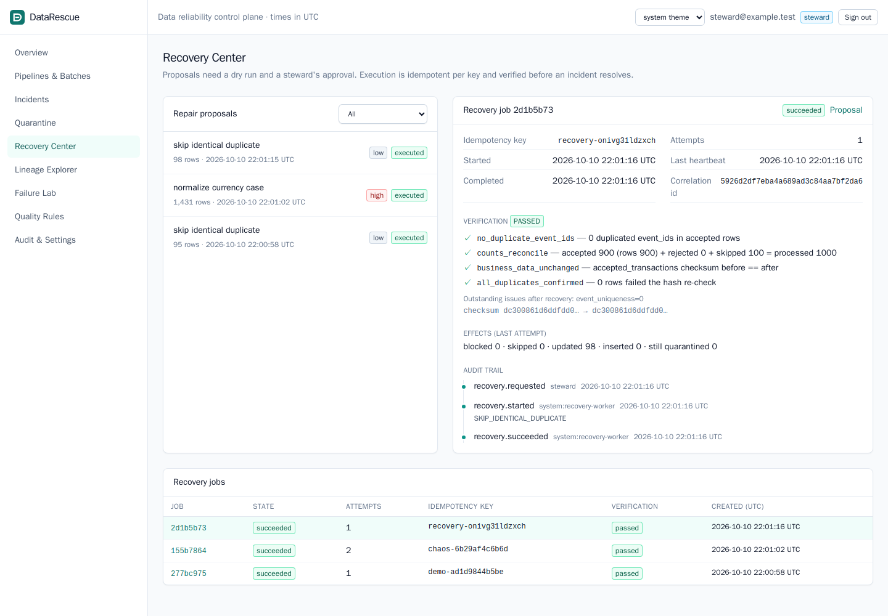

# DataRescue

A data reliability control plane for batch transaction pipelines. It validates incoming
events against a contract, quarantines bad rows without losing them, opens incidents when
quality rules breach their thresholds, explains the likely cause from evidence, traces the
downstream datasets and KPIs at risk, and runs human-approved, idempotent repairs that are
verified before an incident is closed.

All data is synthetic. This is a portfolio and learning project, not a certified financial
system.



## Contents

- [Why](#why)
- [What it does](#what-it-does)
- [Stack](#stack)
- [Architecture](#architecture)
- [Repository layout](#repository-layout)
- [Requirements](#requirements)
- [Quick start](#quick-start)
- [Configuration](#configuration)
- [Troubleshooting](#troubleshooting)
- [Demo walkthrough](#demo-walkthrough)
- [Tests](#tests)
- [Benchmarks](#benchmarks)
- [API](#api)
- [Known limitations](#known-limitations)
- [Future work](#future-work)

## Why

Most pipelines fail in mundane ways: a producer retries a batch, an upstream deploy renames
a field, currency codes arrive in lower case, a batch never shows up. The usual responses,
dropping rows or hand-editing production tables, lose evidence and invite double counting.
DataRescue treats each of these as an incident with a lifecycle: detect it, keep the
evidence, explain it, propose a bounded fix, get approval, apply it idempotently, and prove
the result.

## What it does

- **Streaming ingestion** of CSV or JSONL in 1,000-row chunks with a durable checkpoint.
  A crashed batch resumes where it stopped and never double counts.
- **Raw evidence first.** Every received row lands in `raw_events` before any decision.
- **Contract and business validation:** required fields, Decimal-only amounts (> 0, at most
  two decimals), currency allowlist, status enum, schema version, unexpected and missing
  fields, impossible timestamps, and unparseable rows. Late events are detected against an
  event-time watermark with a per-source grace window.
- **Deduplication enforced by the database.** An identical repeat is skipped. A repeated
  `event_id` with a different payload is quarantined as a conflict.
- **Batch rules:** completeness (manifest count and sequence gaps), volume against a
  median baseline, and per-source freshness.
- **Incidents** with a server-enforced state machine, optimistic locking and a full audit
  trail.
- **Deterministic diagnosis** that ranks suspected causes with heuristic confidence labels,
  cites the supporting and contradicting evidence, and recommends actions. Optional LLM
  enrichment is feature-flagged, sees only redacted data, and is labelled unverified.
- **Dataset-level lineage** from source to dbt marts to dashboards, with BFS blast-radius
  analysis.
- **Bounded repairs:** `SKIP_IDENTICAL_DUPLICATE`, `NORMALIZE_CURRENCY_CASE`,
  `REPLAY_QUARANTINED`, `RETRY_MISSING_BATCH` and `MANUAL_REVIEW_REQUIRED`. Every repair
  goes proposal → dry run → steward approval → execution under an idempotency key →
  verification.
- **Failure lab** with 17 deterministic fault scenarios carrying ground-truth labels, so
  each detection is scored for false positives and misses.
- **dbt marts** for daily revenue and merchant settlements, with tests that reconcile the
  marts against staging.
- **Optional adapters:** a Kafka/Redpanda micro-batch consumer and an Airflow DAG, each
  behind a Compose profile.

## Stack

| Layer | Choice |
|---|---|
| API | Python 3.12, FastAPI, Pydantic v2, SQLAlchemy 2, Alembic |
| Database | PostgreSQL 16 (system of record; JSONB evidence, CHECK and trigger guards) |
| Background work | Redis 7 + RQ worker, built-in scheduler process |
| Frontend | React 18, TypeScript, Vite, React Router, TanStack Query, Recharts, Tailwind |
| Analytics | dbt-postgres 1.8 |
| Optional | Redpanda (Kafka API) consumer, Airflow 2.10 DAG, Anthropic SDK for LLM enrichment |
| Tooling | pytest, Ruff, mypy, ESLint, tsc, Playwright, GitHub Actions, Docker Compose, make |

## Architecture



Ingestion path inside the worker, per 1,000-row chunk and in one transaction:



More detail, including the recovery sequence and design tradeoffs, is in
[docs/architecture.md](docs/architecture.md).

## Repository layout

```
backend/
  app/
    api/           FastAPI routers (system, data, incidents, recovery, ops)
    models/        SQLAlchemy models and enums
    schemas/       Pydantic request/response models
    services/      ingestion engine, quality evaluation, incidents, pipeline, metrics, audit
    quality/       event contract, row validator, rule catalog
    diagnosis/     deterministic engine, optional LLM enrichment, redaction
    lineage/       graph traversal and lineage service
    recovery/      target resolution, proposals and approval, executor and verification
    datagen/       deterministic synthetic data and fault injection
    workers/       queue, task bodies, worker and scheduler entry points
    security/      password hashing, JWT, role permissions
    repositories/  pagination helper
  alembic/         migrations (0001 schema, 0002 integrity triggers)
  tests/           unit/ and integration/ (pytest)
frontend/          React console, Playwright smoke tests in e2e/
dbt/               staging view, revenue and settlement marts, tests
scripts/           seed, fixture generator, scripted demo, benchmark
data/              sample/ (small CSV), fixtures/ (manifests; data regenerated), benchmarks/
optional/          kafka/ producer and consumer, airflow/ DAG
docs/              architecture, data contracts, API, runbook, security, ADRs
infra/             Postgres init script (test and benchmark databases)
```

## Requirements

| Tool | Why | How to get it on a Mac |
|---|---|---|
| Docker Desktop with Compose v2.24+ | runs every service, test and tool | [docker.com/products/docker-desktop](https://www.docker.com/products/docker-desktop/) (Apple Silicon or Intel build) |
| GNU make | the commands below | `xcode-select --install` (preinstalled on most Macs) |
| git (only to clone or push) | | included with the Xcode command line tools |

Python, Node, PostgreSQL, Redis and dbt all run inside containers, so none of them need
to be installed on the host. Give Docker Desktop at least 4 GB of memory (Settings →
Resources). Developed and verified on an Apple M4 (arm64); all images are multi-arch, so
Intel Macs and Linux work too.

## Quick start

**1. Get the code.** Either unzip the release archive or clone the repository:

```bash
unzip datarescue-ai.zip && cd datarescue-ai
# or: git clone https://github.com/<you>/datarescue-ai.git && cd datarescue-ai
```

**2. Configure (optional).** `make setup` creates `.env` from
[.env.example](.env.example) if it doesn't exist. The defaults work as they are for local
use. The optional LLM diagnosis enrichment is **off** (`LLM_ENABLED=false`) and nothing
requires an API key.

**3. Build, migrate and seed, then start:**

```bash
make setup        # copy .env, build images, wait for Postgres, apply migrations, seed demo data
make up           # start postgres, redis, api, worker, scheduler, frontend
```

The first build downloads base images and Python/Node dependencies; see
[Troubleshooting](#troubleshooting) if it is slow. `docker compose up --build` on its own
also works, because the one-shot `migrate` service applies migrations and seeds before
the API starts.

**4. Open the app.**

- Console: http://localhost:5173
- API docs (OpenAPI): http://localhost:8000/docs
- Health: http://localhost:8000/api/v1/ready

Demo accounts (development only; the password for all of them is `datarescue-demo`):

| Account | Role | Can |
|---|---|---|
| `engineer@example.test` | engineer | ingest, run failure scenarios, diagnose, propose repairs, execute approved recoveries |
| `steward@example.test` | steward | everything an engineer can triage, plus approve or reject repairs |
| `admin@example.test` | admin | all of the above, edit rules, read the audit log |
| `analyst@example.test` | analyst | read only |

**5. Run the tests** (details in [Tests](#tests)):

```bash
make test         # backend pytest (unit + integration) and frontend lint, typecheck, build
make lint         # ruff, formatting, mypy, eslint, tsc
make e2e          # Playwright UI tests against the running stack (needs `make up`)
make demo         # scripted failure -> diagnosis -> approval -> recovery via the API
make dbt          # build and test the analytics marts
```

**6. Stop.**

```bash
make down         # stop, keep data
make reset        # delete all data volumes and start fresh (asks you to type 'reset')
```

Other commands: `make logs` (follow api, worker, scheduler), `make seed` (re-run the
idempotent seed), `make benchmark`, `make streaming-up` (optional Redpanda + Kafka
consumer), `make orchestration-up` (optional Airflow on :8080), and `make help` for the
full list. Compose profiles keep the optional services out of the base stack: `test`,
`analytics`, `optional-streaming` and `optional-orchestration`.

## Configuration

`.env` is read by every backend container; Compose supplies the database and Redis URLs.
The settings you are most likely to change:

| Variable | Default | Purpose |
|---|---|---|
| `JWT_SECRET` | dev placeholder | HS256 key, at least 32 bytes. Startup refuses the placeholder when `ENVIRONMENT=production`. |
| `CHAOS_ENABLED` | `true` in `.env.example` | Allows `chaos_crash_after` on recoveries, for failure demos |
| `FRESHNESS_CHECK_INTERVAL_SECONDS` | `300` | Scheduler period for freshness checks and the stale-job reaper |
| `INGESTION_CHUNK_SIZE` | `1000` | Rows per transaction and checkpoint |
| `MAX_UPLOAD_BYTES` | 50 MB | Upload limit |
| `LLM_ENABLED`, `LLM_API_KEY`, `LLM_MODEL` | off | Optional diagnosis enrichment (see [ADR 0003](docs/decisions/0003-deterministic-diagnosis.md)) |

To turn on the LLM enrichment later, set `LLM_ENABLED=true` and `LLM_API_KEY=...` in
`.env`, add `anthropic>=1.0` to the backend image (the `llm` extra in
`backend/pyproject.toml`), and run `make up`. Never commit `.env`; it is gitignored.

Quality thresholds such as allowed currencies, maximum amount and failure percentages live
in the `quality_rules` table. Admins edit them in the UI, and each change is versioned
and audited.

## Troubleshooting

| Problem | Fix |
|---|---|
| `port is already allocated` (5432, 6379, 8000 or 5173) | Another Postgres, Redis or dev server is using the port. Stop it, or change the left-hand port in `docker-compose.yml`. |
| `make setup` stalls on the first build | It is downloading images and dependencies; later builds use the cache. Check Docker Desktop has network access and enough disk space. |
| Containers restart or are killed | Raise Docker Desktop's memory to 4 GB or more. |
| The UI shows a blank page or errors | `make ps` should list api, worker, scheduler and frontend as up; `make logs` shows API errors with correlation IDs. |
| Running a second copy at the same time | `COMPOSE_PROJECT_NAME=other make setup` gives it separate volumes and networks (stop the first copy first, since the host ports are fixed). |

More operational procedures are in [docs/runbook.md](docs/runbook.md).

## Demo walkthrough

The same flow runs three ways: by hand in the browser, scripted against the API with
`make demo`, and as a Playwright test (`make e2e`).

1. Sign in as **engineer@example.test**. The overview shows the seeded, healthy batches.
2. In **Failure Lab**, inject `duplicate event ids` into a 1,000-row batch at 10%. The
   worker ingests it and the result card compares observed counts with the generator's
   ground truth: 900 accepted, 100 skipped, 0 false positives.
3. Choose **Inspect incident**. The incident shows the `event_uniqueness` failure, its
   evidence (sample rows, duplicate analysis, run log) and the lineage path to
   `dashboard_revenue`.
4. The deterministic diagnosis ranks *non-idempotent upstream retry* first, with high
   confidence and cited evidence, and recommends `SKIP_IDENTICAL_DUPLICATE`.
5. Choose **Propose**, then **Run dry run**. The preview lists the duplicate rows to be
   confirmed and shows that 0 rows would be inserted. Engineers cannot approve.
6. Sign in as **steward@example.test**, open the proposal, then **Approve** and
   **Execute recovery**. The job page shows the verification checks (no duplicate IDs,
   counts reconcile, business data unchanged) and the audit trail. The incident moves to
   RESOLVED.
7. Choose **Submit again with the same key**. The finished job is returned and no rows
   are added.

`make demo-chaos` also crashes a currency repair of about 1,400 rows partway through,
retries it with the same idempotency key, and shows that it wrote exactly the rows the dry
run predicted.

| Incident and diagnosis | Recovery verification |
|---|---|
|  |  |

## Tests

```bash
make test         # backend pytest + frontend lint, typecheck, build
make lint         # ruff, ruff format --check, mypy, eslint, tsc
make e2e          # Playwright smoke tests against the running stack
```

Results from the last local run (2026-10-10, Apple M4, Docker Desktop):

| Check | Result |
|---|---|
| `pytest` (unit + integration, real PostgreSQL 16) | 172 passed |
| Migrations up → down → up | pass |
| `ruff check` / `ruff format --check` (backend, scripts, optional) | pass |
| `mypy app` | no issues in 65 files |
| ESLint, `tsc --noEmit`, `vite build` | pass |
| `dbt build` | 23 of 23 pass (3 models, 20 tests) |
| Playwright UI smoke tests (walkthrough, read-only role, no horizontal scroll at 375 px on 13 views) | 3 passed |
| `make demo-chaos` against the running stack | completed, every verification check passed |
| Airflow `dags test datarescue_pipeline` | all 6 tasks succeeded against the live API |

The integration suite covers every fault scenario against ground truth, crash-and-resume
ingestion, crash-and-retry recovery, concurrent executors, approval rules and separation
of duties, the append-only audit trigger, Kafka micro-batch replays (without a broker), and HTTP behaviour: auth failures, 403, 404,
409, 422, 503 when Redis is unreachable, and CSV formula neutralization. See
[IMPLEMENTATION_STATUS.md](IMPLEMENTATION_STATUS.md) for the acceptance matrix.

## Benchmarks

`make benchmark` runs [scripts/benchmark.py](scripts/benchmark.py) against a separate
database that is reset before each size. Each size uses a `mixed_faults` dataset with 10%
faulty rows (seed 42) and runs in its own process, so memory figures are per size.

Measured 2026-10-10 on an Apple M4 (10 cores), Docker Desktop VM with 7.7 GB visible,
PostgreSQL 16.15 in a container, Python 3.12, one synchronous ingestion process:

| Records | Generate rows/s | Validate rows/s | Ingest rows/s | Ingest time | Counts = ground truth | False pos. / neg. | Re-send same file: rows added | Crash + retry recovery | Peak RSS |
|---:|---:|---:|---:|---:|:-:|:-:|---:|---:|---:|
| 1,000 | 134,318 | 165,821 | 4,315 | 0.23 s | yes | 0 / 0 | 0 | 0.05 s, verified | 147 MB |
| 10,000 | 150,261 | 168,313 | 5,734 | 1.74 s | yes | 0 / 0 | 0 | 0.20 s, verified | 148 MB |
| 100,000 | 154,380 | 169,185 | 6,057 | 16.5 s | yes | 0 / 0 | 0 | 1.87 s, verified | 148 MB |

How to read this:

- **Ingest** covers reading, hashing, raw evidence, validation, accepted/quarantine writes,
  quality evaluation and the incident. The database round trips dominate; validation
  alone runs at roughly 165k rows/s.
- **Detection latency** equals ingestion time here, because batch rules are evaluated when
  the batch finishes. That is a design choice, not streaming detection.
- **Peak RSS** stays flat from 1k to 100k because files are streamed and never loaded
  whole.
- **Replay correctness:** for every size, a `NORMALIZE_CURRENCY_CASE` recovery was crashed
  halfway and retried with the same key. Rows written equalled the dry-run prediction (4,
  82 and 841 rows), with zero duplicate event IDs, and a third submission returned
  `completed`.
- These are single-machine figures from one run, not a capacity claim.

Raw output is written to `data/benchmarks/results-<timestamp>.json` (gitignored).

## API

Base path `/api/v1`. Errors share one shape:
`{"code", "message", "details", "correlation_id"}`. Lists use `limit` and `offset`.
Long-running operations return `202` with a status URL. The full reference with examples,
including 400/401/403/404/409/422/503 cases, is in [docs/api.md](docs/api.md); interactive
docs are served at `/docs`.

| Method and path | Purpose |
|---|---|
| `GET /health`, `GET /ready` | liveness; database and queue readiness |
| `POST /auth/login`, `GET /auth/me` | bearer token; current user and permissions |
| `GET/POST /sources` | list sources; create (admin) |
| `POST /datasets/generate` | seeded synthetic dataset with ground-truth manifest |
| `POST /ingestions`, `POST /ingestions/upload` | ingest a generated dataset or an uploaded file (idempotent per request key / file hash) |
| `GET /batches`, `GET /batches/{id}`, `POST /batches/{id}/resume` | batches, rule results and run log; resume from checkpoint |
| `GET /quality/rules`, `PATCH /quality/rules/{id}`, `GET /quality/results` | rules (versioned, audited) and results |
| `GET /incidents`, `GET /incidents/{id}` | list and filter; detail with evidence, diagnosis, timeline |
| `POST /incidents/{id}/acknowledge`, `/close`, `/diagnose` | transitions (with justification); queue diagnosis |
| `GET /lineage`, `GET /incidents/{id}/impact` | dependency graph; downstream impact |
| `GET /quarantine`, `GET /quarantine/{id}`, `GET /quarantine/export.csv` | failed rows, reason codes; CSV export |
| `POST /repairs/proposals`, `/{id}/approve`, `/{id}/reject` | bounded proposals and review |
| `POST /recoveries/dry-run`, `POST /recoveries`, `GET /recoveries/{id}` | preview; execute with idempotency key; state and verification |
| `POST /simulations`, `GET /simulations` | fault injection and evaluation |
| `GET /metrics/overview`, `/timeseries`, `/revenue` | dashboard statistics; dbt revenue mart |
| `GET /audit` | audit log (admin) |

## Known limitations

- **Single tenant, local auth.** Demo accounts with JWTs and four fixed roles. No SSO,
  password reset, user management UI or token revocation.
- **Batch-level detection.** Rules run at the end of each batch. A very large batch
  surfaces its incident only when it finishes.
- **Dataset-level lineage** comes from declared edges. Impact is "this dataset is
  downstream", not "these rows changed".
- **Diagnosis is heuristic.** Confidence labels are not calibrated probabilities. The LLM
  path is implemented and unit-tested with stubbed responses, but was not exercised
  against a live API key during development.
- **`RETRY_MISSING_BATCH` only works for the synthetic source**, which can regenerate a
  batch deterministically. A real source would need a redelivery request to the producer.
- **Kafka is at-least-once.** Replays of the same offset range map onto the original batch.
  If a replay is chunked differently, accepted rows are still protected by `event_id`
  uniqueness, but the rows show up as skipped duplicates in a new batch.
- **Audit rows are append-only by trigger.** A database superuser can still disable the
  trigger; there is no external tamper evidence.
- **Throughput** is one process per batch, around 6k rows/s on the machine above. There
  is no partitioning or parallel chunk processing.
- **No PCI scope.** The generator never produces card numbers, and there is no compliance
  claim.

## Future work

- Parallel chunk workers and `COPY`-based raw loading for higher ingest rates
- Incremental (per-chunk) rule evaluation for earlier detection on large batches
- Column-level lineage from dbt manifests
- OpenTelemetry traces across API, worker and database
- Alert delivery (Slack, email) with acknowledgement links
- OIDC login and finer-grained, per-source permissions
- Great Expectations adapter for teams with existing suites

## License

[MIT](LICENSE)
