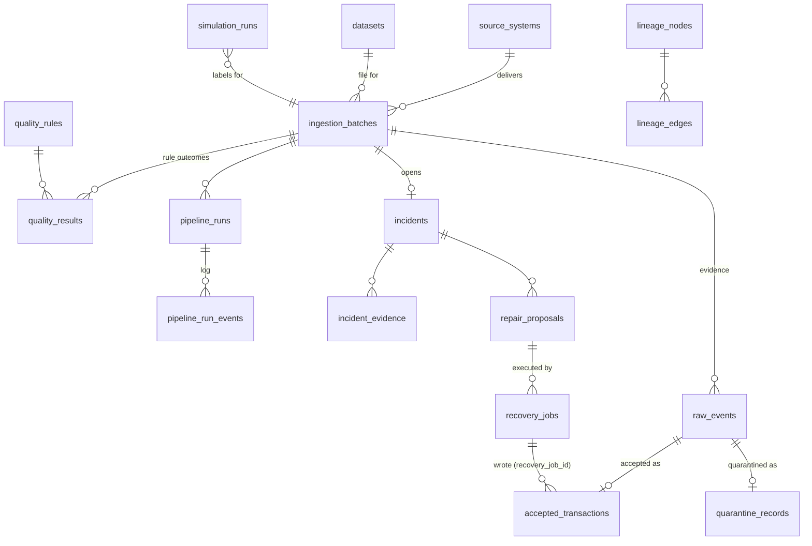

# Architecture

## Components

| Component | Process | Responsibility |
|---|---|---|
| API | `uvicorn app.main:app` | Auth, RBAC, request validation, all reads, creating batches/proposals/jobs, enqueueing work |
| Worker | `python -m app.workers.main worker` (RQ) | Ingestion, diagnosis, recovery execution |
| Scheduler | `python -m app.workers.main scheduler` | Freshness checks per source, reaping recovery jobs whose executor died |
| PostgreSQL 16 | | System of record: raw evidence, accepted rows, quarantine, rules/results, incidents, lineage, proposals, jobs, audit |
| Redis 7 | | RQ queue and retry scheduling, per-user rate-limit counters |
| Frontend | nginx serving the Vite build | Console; proxies `/api` to the API |
| dbt (profile `analytics`) | one-shot container | `analytics.stg_accepted_transactions` view, revenue and settlement marts |
| Kafka consumer (profile `optional-streaming`) | | Micro-batches Redpanda messages into the same ingestion engine |
| Airflow (profile `optional-orchestration`) | | Hourly DAG calling the API and dbt |

The API never does heavy work inline. In tests and in the seed script, `TASK_MODE=sync`
runs task bodies in-process, using the same code paths without Redis.

## Data model



Key integrity rules enforced by the database, not just the application:

- `accepted_transactions.event_id` is unique. This is the final guard against duplicate
  business rows.
- `raw_events` is unique on `(batch_id, event_id, payload_hash)`. Identical repeats inside
  a batch collapse into one evidence row with an `occurrences` count.
- `quarantine_records.raw_event_id` is unique, so re-processing never double-quarantines.
- `ingestion_batches` has the CHECK `accepted + rejected + skipped = processed`.
  Counters move in the same transaction as the rows they describe.
- `amount > 0`, `currency ~ '^[A-Z]{3}$'` and the status enum are CHECK constraints on
  accepted rows.
- Triggers (migration `0002`): `audit_events` rejects UPDATE and DELETE; incidents in
  RESOLVED or CLOSED_AS_FALSE_POSITIVE and proposals in REJECTED or EXECUTED cannot
  change state.
- A high-risk proposal cannot have `reviewed_by = created_by` (CHECK).

The full table reference is in [data_contracts.md](data_contracts.md#database-tables).

## Ingestion

[`services/ingestion.py`](../backend/app/services/ingestion.py) processes a file in chunks
of `INGESTION_CHUNK_SIZE` rows. Each chunk is one transaction:

1. Hash each row with a canonical, format-independent serialization (CSV `"12.50"` and
   JSON `12.50` hash the same). Derive a stable `event_id` (UUIDv5 of source and hash) for
   rows without one.
2. Upsert `raw_events` and get back which rows are new and which repeat earlier rows in
   the batch (`xmax = 0`).
3. Settle rows whose `event_id` is already accepted, in an earlier batch or earlier in this
   chunk. An identical payload is skipped; a different payload is quarantined as
   `DUPLICATE_CONFLICT`.
4. Validate the remaining rows in stream order. Only rows about to be accepted advance the
   event-time watermark. A redelivered old event never makes newer rows look late; this
   was a real bug, caught by the live demo and covered by a regression test.
5. Insert accepted rows with `ON CONFLICT (event_id) DO NOTHING` as a race-safe backstop,
   and insert quarantine rows with error codes and per-field details.
6. Update dispositions, counters and the `processed_count` checkpoint, then commit.

When the input is exhausted, `finalize_batch` computes per-rule results from persisted
rows, not in-memory counters, so a resumed batch reports the same numbers as an
uninterrupted one. It then sets the status, computes an order-independent checksum of the
accepted rows, opens or reuses the batch incident, and the task enqueues diagnosis.

A worker crash mid-batch leaves the committed chunks and the checkpoint. RQ retries the
task with exponential backoff (2 s, 8 s, 30 s), and `ingest_rows` skips the rows already
committed.

## Recovery

```mermaid
sequenceDiagram
    actor E as Engineer
    actor S as Steward
    participant API
    participant W as Worker
    participant DB as PostgreSQL
    E->>API: POST /repairs/proposals (action, justification)
    API->>DB: resolve bounded targets, risk, preview; audit
    E->>API: POST /recoveries/dry-run
    API->>DB: read-only evaluation of every target; store summary
    S->>API: POST /proposals/{id}/approve
    API->>API: role check, dry run present, separation of duties for high risk
    S->>API: POST /recoveries (idempotency_key)
    API->>DB: create job or return existing job for this key
    API->>W: enqueue run_recovery(job)
    W->>DB: pg_try_advisory_lock(job)
    loop chunks of 500 targets
        W->>DB: conditional writes (state='OPEN', NOT confirmed, ON CONFLICT DO NOTHING)
        W->>DB: heartbeat, COMMIT
    end
    W->>DB: verify (duplicates, reconciliation, checksum or dry-run match, outstanding issues)
    W->>DB: job SUCCEEDED + incident RESOLVED, or ACTION_REQUIRED with what remains
```

What makes a retry safe:

- **One executor per job.** The worker takes a session-level Postgres advisory lock on a
  connection it invalidates afterwards. If the process dies, the server session ends and
  the lock is released, so a retry can safely take over. A second executor finds the lock
  held and backs off.
- **Per-record idempotence.** Every write is conditional, so a partially applied job
  re-run from the start changes nothing it already changed.
- **Verification uses the job's actual writes** (`accepted_transactions.recovery_job_id`),
  not the counters from the last attempt, so a crash-and-retry is verified against the
  dry run as a whole.
- **Same key, same job.** The key is bound to one proposal. A finished job is returned
  as-is, a failed or abandoned job resumes, and a key reused for a different proposal is
  a 409.

The incident resolves only if verification passes and `outstanding_issues` is zero for
every failed rule (no open quarantine for that rule's codes, no unconfirmed duplicates,
no sequence gaps). Otherwise it returns to ACTION_REQUIRED with a note.

## Diagnosis

[`diagnosis/deterministic.py`](../backend/app/diagnosis/deterministic.py) runs a set of
checks over the incident's evidence. Each check may return hypotheses with the evidence IDs
that support or contradict them, plus recommended actions. Results are sorted by confidence
label, then by how much evidence supports them. Before running, the service adds two
derived evidence items: `repairability` (how many records each action could fix) and
`impact` (lineage traversal).

Optional LLM enrichment ([`diagnosis/llm.py`](../backend/app/diagnosis/llm.py)) receives
a redacted, size-bounded JSON summary inside a data block. Its output is validated against
a schema, citations must refer to evidence IDs it was actually given, and suggested actions
are filtered to the allowlist. The result is stored separately as `ai_enrichment` with
`unverified: true`, and it cannot create proposals. See
[ADR 0003](decisions/0003-deterministic-diagnosis.md).

## Lineage

Nodes and edges are declared in `lineage_nodes` and `lineage_edges`, seeded from
[`lineage/service.py`](../backend/app/lineage/service.py). Impact is a BFS from the
incident's origin node, using a visited set so a bad edge can't loop forever. It reports
each downstream node once, at its shortest path, with a confidence label that decays with
depth. Last-refresh times are observed values (batch finish times, the marts'
`_refreshed_at`) and show as unknown when there is nothing to observe. An origin with no
declared edges returns `status: unknown` rather than an empty "no impact" list.

## Tradeoffs

| Decision | Alternative | Why |
|---|---|---|
| Postgres as the only store, JSONB for evidence | Object storage for raw files plus a warehouse | One transactional boundary for raw rows, accepted rows, counters and audit makes exactly-once effects on our side straightforward. Raw files stay on the data volume. |
| RQ on Redis | Celery, Kafka-only, Airflow as executor | Small and explicit. Retries with backoff are built in. Its weaknesses (no exactly-once) are covered by DB idempotency, see [ADR 0002](decisions/0002-redis-rq.md). |
| Batch-level rule evaluation | Per-row streaming alerts | Thresholds are about proportions of a batch. Evaluating on persisted rows makes resumed batches deterministic. The cost is detection latency equal to batch duration. |
| Chunk-level transactions with a checkpoint | One transaction per batch | Bounded memory and lock time, resumable after a crash. A batch can be partially visible while it runs. |
| Identical repeats skipped, conflicts quarantined | Last-write-wins | A changed payload under the same ID is a data bug or an upstream mutation. Picking a winner silently would hide it. |
| Deterministic diagnosis first | LLM-first | Reproducible, testable, free, and works offline. The LLM can add explanation but not decide. |
| Separate approval and execution permissions | Single "operator" role | Lets a steward gate changes to business data and supports separation of duties for high-risk changes. |
